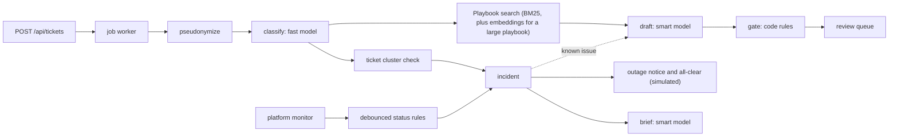

# Zoltar Speaks

AI triage assistant for MacMillan Marketing Company (MMC), a social media and brand agency for high-profile influencers and large brands.

- **Client Services** gets each client request classified, prioritized, and answered with a draft grounded in MMC's playbook. A coordinator approves, edits, or rejects every draft.
- **Social Ops** gets an incident with an AI-written brief when a social platform API degrades or when similar requests arrive from several clients at once. The incident lists which clients to contact first.

Customer assumptions and expected value: [docs/CUSTOMER_CONTEXT.md](docs/CUSTOMER_CONTEXT.md). Design details: [docs/DESIGN.md](docs/DESIGN.md). When something goes wrong: [docs/TROUBLESHOOTING.md](docs/TROUBLESHOOTING.md).

## Try it on a Mac (no technical knowledge needed)

You need a Mac with at least 8 GB of free disk space and an internet connection for the first start. Nothing else: Zoltar downloads what it needs into its own folder and does not ask for your password.

**Option 1: one line in Terminal (easiest).** Open the Terminal app (press Command-Space, type `Terminal`, press Return), paste this line, and press Return:

```bash
curl -fsSL https://raw.githubusercontent.com/tzeappa/zoltar-speaks/main/install.sh | bash
```

It puts Zoltar in a folder called `Zoltar` in your home folder, opens that folder, starts Zoltar, and opens it in your browser.

**Option 2: double-click.** Download the project from GitHub (green "Code" button, then "Download ZIP"), open the ZIP, and double-click **Start Zoltar** in the folder. The first time, macOS says it "could not verify" the file because it was downloaded from the internet. Click Done, open System Settings, go to Privacy & Security, scroll down, and click **Open Anyway** next to "Start Zoltar". macOS only asks once.

**What happens on the first start.** A Terminal window shows the progress. The first start downloads about 5 GB (the AI model) and takes 5 to 15 minutes depending on your connection; later starts take a few seconds. When it is ready, Zoltar opens in your browser at http://localhost:8787. The demo requests then fill in over about 12 minutes while the AI works through them.

**Every day after that.** Double-click **Start Zoltar** in the Zoltar folder (`Zoltar` for the one-line install, or the folder you unzipped). To stop it, close the Terminal window (click Terminate if asked) or double-click **Stop Zoltar**. Stop Zoltar also frees the memory the AI uses; an Ollama you run yourself, such as the Ollama desktop app, keeps running.

**Removing Zoltar.** Double-click **Uninstall Zoltar** in the same folder. It lists what it will remove and asks you to type `yes`. It removes everything Zoltar downloaded or created: the AI model (about 5 GB), the Node.js and Ollama it fetched, its data, logs, and settings, and, for the one-line install, the `Zoltar` folder itself. Anything that was on your Mac before Zoltar, such as your own copy of Ollama, its models, or Node.js, stays.

Everything runs on your Mac. Requests are never sent to an outside AI service unless someone sets that up on purpose. If something goes wrong, the window says what to do; see also [the troubleshooting guide](docs/TROUBLESHOOTING.md#start-zoltar-on-a-mac).

## Developer quick start

```bash
make setup    # Node check, npm packages, .env, Ollama install, model download (~5 GB, first time only)
make dev      # checks Ollama is up (starts it if not), then http://localhost:8787
```

The app always uses a local model through [Ollama](https://ollama.com) (`qwen3:8b` by default), so nothing leaves the machine. Claude is used only when you ask for it: set `AI_MODE=anthropic` and `ANTHROPIC_API_KEY` in `.env`. A key on its own changes nothing. On first start the database is seeded with 12 clients and ~40 requests; on a local model they take about 12 minutes to triage on an Apple M1 Pro, so the queue fills in gradually.

`make setup` needs Node 24+ (built-in `node:sqlite`) and installs it with Homebrew if it is missing. Ollama is installed with Homebrew on macOS and the official script on Linux. Run `make` for every target. The Mac starter above (`scripts/start.sh`) needs neither Homebrew nor `make`, which on a fresh Mac prompts for Apple's developer tools.

| Command | Purpose |
| --- | --- |
| `make setup` | First run: everything below `install`, plus `.env` from `.env.example` |
| `make install` | Node (if missing), npm packages, Ollama, models |
| `make start` | Start Ollama if it is down, pull missing models, then the app in the background, like a service. Returns once the app answers; closing the terminal does not stop it. Does nothing if it is already running |
| `make restart` / `make logs` | Stop and start again / follow `data/zoltar.log` (Control-C stops following, not the app) |
| `make dev` | Like `make start`, but in the foreground with reload on file changes, for development |
| `make services` | Just the Ollama check: start it, pull models, load them into memory |
| `make status` | Report Ollama, models, and the app's `/healthz` without changing anything |
| `make stop` / `make stop-ollama` | Stop the app running from this folder, however it was started / the Ollama server Zoltar started (never the desktop app or `brew services`) |
| `make test` | Typecheck plus unit, integration, and security tests (mock model, in-memory DB) |
| `make check` | The test, smoke, and offline eval steps CI runs, plus shellcheck if installed |
| `make eval` | Accuracy, latency, and cost against the configured model |
| `make reset` | Delete the local database; the next start reseeds |
| `make uninstall` | Remove what Zoltar added to the machine (see below); asks first |

Installers record what they add in `.zoltar-installed` (git-ignored), and only what is listed there gets removed: Homebrew formulas that were not installed before (including dependencies, such as `mlx` for `ollama`), models pulled by `scripts/services.ts`, and `~/.ollama` or `~/.npm` if Zoltar created them. `~/.ollama` is kept if it holds models Zoltar did not pull. In a git clone, `make uninstall` removes `node_modules/`, `data/`, `.runtime/`, `eval/results/`, and `.env` but leaves the source; the whole folder is removed only when `install.sh` created it.

The npm scripts behind these (`npm run dev`, `npm test`, `npm run services`, `npm run eval -- --mock`, ...) work directly too.

**AI modes** (`AI_MODE`):

| Mode | When | Models |
| --- | --- | --- |
| `ollama` | Default (empty) | `OLLAMA_MODEL_FAST` and `OLLAMA_MODEL_SMART`, both `qwen3:8b` by default |
| `anthropic` | Set explicitly; needs `ANTHROPIC_API_KEY` | `MODEL_FAST` (Haiku 5.5) classifies, `MODEL_SMART` (Sonnet 5.5) drafts and writes briefs |
| `mock` | Tests, CI, `--mock` | Deterministic keyword rules, offline, instant |
| `disabled` | Set by hand | No AI; every request goes to manual triage |

### Demo path

1. **Queue.** Escalated requests show why they need a human; suggested ones have a draft ready. The list updates the moment something changes. Keyboard: `j`/`k` to move, `Enter` to open, `a` approve, `e` edit, `r` reject, `n` back to the queue after a review.
2. **Request detail.** Classification, playbook sources, the draft, what the model actually saw (pseudonymized), and every model call with tokens, latency, and cost. Approve, edit, or reject in place. The back link returns to the tab you came from, for example "Back to Draft ready queue".
3. **Platforms.** Set Instagram publishing to `outage`. On the next monitor check an incident opens, a brief is generated, and the incident lists affected clients, platinum first, so coordinators can reach them before they complain.
4. **Simulate ticket spike.** Six publishing complaints from five clients arrive. They link to the open incident and their drafts acknowledge the known issue. Without an open incident, the same spike opens one on its own.
5. **Notify clients.** On the incident, "Notify affected clients" sends every affected client a notice saying the platform caused the problem, not their account. Ops reviews and edits the message first; `{{client}}` and `{{coordinator}}` are filled in per client. Set the platform back to `operational`: after 30 seconds of healthy checks (`MONITOR_RECOVERY_MS`) a green banner offers "Resolve and send all-clear", which resolves the incident and tells everyone who heard about the outage that it is fixed. Delivery is simulated: notices are recorded on the incident, never emailed.
6. **Ops.** Latency, cost, escalation reasons, acceptance rate, queue depth, and the AI kill switch.

## Architecture



- **Server:** Hono on Node, `node:sqlite`, pino logs.
- **UI:** server-rendered Hono JSX. htmx for in-place updates (review actions, live refresh pushed over Server-Sent Events). No client build.
- **AI:** Anthropic API (Haiku 5.5 classifies, Sonnet 5.5 drafts and briefs) through tool use, or a local model through Ollama with schema-constrained JSON output. Both validated with zod. Mock client with the same interface for tests.
- **Retrieval:** MiniSearch (BM25) over markdown in `server/kb/`, fused with embeddings from a local Ollama model (`nomic-embed-text`) once the playbook is large or `KB_SEARCH=hybrid`.
- **Monitoring:** pluggable status sources per platform: simulated (default), Statuspage JSON, or HTTP probe.

```
server/
  ai/         model clients (Anthropic, Ollama, mock), structured calls, schemas, prompts, pricing
  pipeline/   redact, classify, retrieve, draft, gate, incidents, worker, triage
  monitor/    status sources, trigger rules, monitor loop
  notify/     client notices: templates, recipients, simulated delivery
  routes/     JSON API and HTML pages
  views/      JSX pages and htmx partials
  db/         schema and queries
  kb/         playbook articles and runbooks
  seed/       clients and labeled requests
tests/        unit, integration, security
scripts/      eval, eval-retrieval, smoke, reset, services (Ollama check and start), daemon (make start), start, stop, settings, uninstall, brew-install (Mac starter)
.github/      CI workflow, Dependabot
Makefile      setup, install, dev, start, stop, restart, logs, status, test, check
Start/Stop/Uninstall Zoltar.command, install.sh       Mac starter for non-technical users
```

### JSON API

Every POST needs `Content-Type: application/json`, even without a body (see Security).

| Endpoint | Purpose |
| --- | --- |
| `POST /api/tickets` | Ingest a request: `client_id`, `subject`, `body`, optional `channel` (`email` or `portal`) and `external_id` (repeat posts return the same ticket) |
| `GET /api/tickets`, `GET /api/tickets/:id` | Queue and full ticket detail with model calls |
| `POST /api/tickets/:id/review` | `action`: `approve` or `reject`; optional `body` (the edited reply) and `note` |
| `POST /api/tickets/:id/retriage` | Run triage again |
| `GET /api/incidents`, `GET /api/incidents/:id` | Incidents with timeline, affected clients, and notices |
| `POST /api/incidents/:id/ack`, `/resolve`, `/regenerate-brief` | Ops actions |
| `POST /api/incidents/:id/notify` | Mark one client notified by hand: `{"client_id"}` |
| `POST /api/incidents/:id/notify-all` | Send the outage notice; optional `subject` and `body` override the template |
| `POST /api/incidents/:id/resolve-notify` | Resolve and send the all-clear; same optional fields |
| `GET /api/platforms`, `POST /api/platforms/simulate`, `POST /api/monitor/run` | Platform health board, set a simulated status, run checks now |
| `POST /api/simulate/spike` | Demo: six publishing complaints from five clients |
| `POST /api/settings/ai` | Kill switch: `{"enabled": false}` |
| `GET /api/metrics`, `GET /api/clients`, `GET /api/kb/:id` | Ops metrics, client roster, playbook article |
| `GET /healthz` | Health check |

## Assumptions

- Requests arrive as text through an API (email or portal integration is out of scope).
- The client roster is known, including which platforms each client uses and a contact email for outage notices.
- A human always sends the reply. The system never acts on client accounts.
- Platform health comes from status feeds or synthetic probes MMC configures. No reliable official status API exists for every platform, so the source is configurable per platform.
- One office, one process, a few hundred requests per day with outage bursts.
- English is the working language; other languages are classified and replied to in kind but escalate more often due to lower confidence.

## Trade-offs

**Latency vs. quality.** By default one local model (`qwen3:8b`) does both steps. With `AI_MODE=anthropic`, classification uses Haiku: it runs on every request, the output is short and structured, and the code gate backstops routing mistakes. Drafting and incident briefs use Sonnet, where tone for high-profile clients matters. Drafting dominates latency. Triage runs asynchronously, so coordinators never wait on a spinner; the request appears in the queue when ready.

**Cost.** Nothing per call with Ollama. With Anthropic, each request costs one Haiku call and one Sonnet call. Incident briefs add a Sonnet call when the incident opens, when the first client report arrives, and every 5 reports after that, not per ticket. A per-ticket token budget caps runaway prompts.

**Accuracy vs. safety.** The gate escalates aggressively: any risky action, sensitive category, low confidence, or ungrounded draft goes to a human. Security, press, legal, and money keywords (including common Spanish, French, and German terms) escalate even if the model misreads the request, so one wrong classification is not enough to auto-suggest a dangerous reply. This lowers the share of one-click drafts. Thresholds are env settings.

**Local vs. hosted model.** Ollama keeps every request on the machine, costs nothing per call, and needs no account, which is why it is always the default; Claude runs only with `AI_MODE=anthropic`. The price is speed and quality: an 8B model on a laptop is several times slower than Haiku and Sonnet and makes more classification mistakes. The gate's keyword, category, and confidence rules apply the same way to both, so a weaker model mostly means more requests sent to a human, not risky ones auto-suggested. Structured output works differently: Ollama constrains generation to the JSON schema (`format`), where Anthropic uses tool calls, and both go through the same zod validation and repair turn.

**Pseudonymization vs. context.** The model never sees client names, which costs some context (it knows tier and industry, not identity). For MMC's clients that trade is worth it.

**Detection speed vs. false alarms.** A `degraded` status must last 20 seconds before an incident opens (`MONITOR_DEGRADED_MS`); `outage` opens on the first check. Recovery is noted after 30 seconds operational (`MONITOR_RECOVERY_MS`). Both are durations, so running checks more often cannot speed them up. Ticket clusters need 3+ distinct clients. Both delay detection slightly to avoid paging Ops for a blip or one noisy client. A monitoring source that fails (Statuspage errors, connection errors, a misconfigured probe URL) reports `unknown`, which never opens an incident; an HTTP probe that times out or returns 5xx counts as an outage. Once Ops resolves an incident, the same ongoing failure does not reopen it.

**Server-rendered UI.** The workflow is a queue, a detail page, and a few actions, with all state on the server. Hono JSX plus htmx gives in-place review actions, live updates, and keyboard shortcuts with no client build. A React client would only pay off for heavy client-side interaction; the JSON API is kept separate so one can be added later. Pages update over Server-Sent Events: the server pushes which kind of data changed, and only the parts showing it reload. An idle queue or incident page makes no requests apart from a refresh every minute, where polling made one every 2 to 5 seconds per open page. The Platforms and Ops pages also refresh after each monitor check (every 10 seconds), since that is new data.

**Keyword vs. hybrid search.** BM25 alone is fast, deterministic, and enough for a small playbook with distinctive wording. Embeddings catch paraphrases it misses (measured below) at the cost of a second local model (about 270 MB) and an embedding call per search. `KB_SEARCH=auto` switches to hybrid at 40 documents (`KB_HYBRID_MIN_DOCS`); the playbook has 20 today. If the embedding model is unavailable, search falls back to BM25 rather than failing the request.

**SQLite jobs vs. a queue.** Chosen for simplicity at this size. See [docs/DESIGN.md](docs/DESIGN.md#scaling) for when to switch.

### Measured

`AI_MODE=anthropic npm run eval` on the 40 labeled seed requests, run end to end through the real pipeline. The Anthropic default is Haiku 5.5 classifying and Sonnet 5.5 drafting; one step up (Sonnet classifying, Opus drafting) is shown for comparison.

| Metric | Haiku / Sonnet (default) | Sonnet / Opus |
| --- | --- | --- |
| Category / platform / requested action accuracy | 88% / 95% / 83% | 93% / 93% / 90% |
| Priority exact / within one level | 75% / 100% | 70% / 100% |
| Escalation recall (requests the labels say need a human) | 100% (16 of 16) | 100% (16 of 16) |
| Over-escalation (safe requests sent to a human) | 54% (13 of 24) | 46% (11 of 24) |
| Invalid outputs / API errors | 0 / 0 | 0 / 0 |
| Classify p50 | 1.8 s | 2.8 s |
| Model time per request p50 / p95 | 7.4 s / 14.2 s | 11.1 s / 13.6 s |
| Cost per request | $0.021 (about $3/day at 150 requests) | $0.041 (about $6/day) |

Recall is the number that matters: in both setups no request that needed a human was auto-suggested. The larger models classify a few points better on category and action, at twice the cost. Since the gate catches risky requests through keywords and category rules either way, the cheaper pair is the default. Most over-escalations come from the drafting model rating its own draft as low confidence or ungrounded (thank-you notes, scheduling questions where the playbook only partly applies). These are safe failures. Tuning `CONFIDENCE_THRESHOLD` against coordinator edit rates is the first post-launch task. The mock model scores higher on this set only because its keyword rules were written against it.

**Local model.** The same eval with Ollama and `qwen3:8b` for both steps, on an Apple M1 Pro (32 GB):

| Metric | qwen3:8b on Ollama |
| --- | --- |
| Category / platform / requested action accuracy | 80% / 88% / 78% |
| Priority exact / within one level | 63% / 100% |
| Escalation recall | 100% (16 of 16) |
| Over-escalation | 21% (5 of 24) |
| Invalid outputs / errors | 0 / 0 |
| Model time per request | about 20 s alone (classify 10 s, draft 9 s); 34 s p50 with two requests queued |
| Cost per request | $0 |

It classifies about 8 points worse than Haiku and is roughly three times slower. The first run missed one escalation: a pricing question ("What would that cost?") filed under Campaign Strategy instead of Billing. That led to the pricing keyword rule in the gate, so a draft can never quote a price whatever the category, and the rerun above catches all 16. Over-escalation looks better than Claude's, but only because the local model rates nearly every draft at 0.95 confidence, so the low-confidence rule rarely fires. Treat that as a weaker safety net, not a better model. Schema-constrained output gave no invalid outputs, without the schema reordering Haiku needed.

**Playbook retrieval.** `npm run eval:retrieval` asks 20 paraphrased questions with a known right document (for example "Our reel never appeared on the feed" for the publishing-failures article), worded to avoid each article's own terms, plus 4 unrelated questions that should find nothing. With `nomic-embed-text`:

| Metric | Keyword (BM25) | Hybrid |
| --- | --- | --- |
| Right document first | 40% | 85% |
| Right document in top 3 | 55% | 95% |
| Mean reciprocal rank | 0.46 | 0.90 |
| Unrelated questions that retrieved something | 3 of 4 | 0 of 4 |

BM25 with fuzzy matching finds something in almost any text ("weather in Lisbon tomorrow" matched three articles), which can hand the drafting model an irrelevant article. In hybrid mode a keyword match must also be at least somewhat similar (`KB_KEYWORD_MIN_SIMILARITY`, 0.5), and an embedding-only match needs 0.6 (`KB_MIN_SIMILARITY`). Both floors were chosen on this set, which is small, so recheck them on real requests and after changing the embedding model. Real triage queries also include the classified category and platform, which helps BM25 more than these bare questions do.

**Structured output.** Haiku accepts a forced tool call. Sonnet and Opus 5.5 reject it, so the client falls back to `tool_choice: auto` for those models and replays thinking blocks in repair turns. Zod validation catches anything off-schema. Haiku initially dropped fields after writing a long rationale (14 invalid outputs, 5 requests still invalid after the repair retry); putting routing fields first in the schema and capping the rationale at two sentences brought that to 0.

## Reliability

- Model output is schema-validated; one repair retry, then human.
- Transient API errors retry with backoff; final failure still lands the ticket in the queue for manual triage. A stopped Ollama counts as transient, so tickets wait in Needs human with "AI unavailable" instead of being lost; a missing Ollama model fails at once with the `ollama pull` command to run.
- `make dev` and `make start` check Ollama before starting the app and start it if it is down. The server checks again at startup and logs what is wrong, and `/healthz` reports `degraded` while Ollama is unreachable or a model is missing.
- Citations are verified against retrieved documents.
- Incidents are never auto-resolved. Recovery is recorded and shown as a banner; Ops resolves. If the platform fails again, the banner goes away.
- Client notices are never sent twice: each is claimed in the database before sending, so double clicks and concurrent coordinators are safe. Failed sends are retried on the next send, and a send cut off by a restart is marked failed at startup so it can be retried.
- Notices are drafted from templates, not by the model, so they still work with AI off.
- The kill switch (`AI_MODE=disabled` or Ops panel) keeps the queue, monitoring, and notices working without AI. It also stops brief jobs that were already queued.
- A job interrupted by a restart is retried; one interrupted on its last attempt fails instead of looping, and its ticket goes to manual triage.
- Re-triage is refused while triage is still running and on a ticket that was already approved, edited, or rejected, so a client cannot get two replies. A re-triaged ticket leaves an incident it no longer matches.
- A notice is refused if the recipients changed after the form was opened, so the count in "Send to 5 clients?" is the count that gets it.
- A gap in monitor readings (server stopped, laptop asleep, a failing source) breaks a streak instead of counting as the problem lasting.
- Settings are validated at startup: a zero or negative concurrency, timeout, or interval, a fraction where a whole number belongs, a threshold above 1, an unknown platform or bad URL in `MONITOR_SOURCES`, and `MONITOR_ENABLED=maybe` are all rejected rather than silently misbehaving.
- Older databases are upgraded in place at startup.

Tests cover the gate rules, pseudonymization round-trip, schema validation and repair (including split tool calls and JSON-encoded fields), the Ollama client (request shape, repair turns, missing models, a stopped server), citation checks, cluster thresholds, monitor trigger rules and recovery tracking, status source parsing, retrieval, config, metrics and health, client notices (templates, recipients, no double sends, retries, all-clear, missing emails), and the full pipeline with the mock model including failure and incident scenarios.

## Security

- **Client confidentiality:** client names, aliases, emails, phones, cards, and credentials ("password is ...", "the password to our account is ...", 2FA codes) are replaced before any model call, including incident briefs. With Ollama on this machine (the default `OLLAMA_URL`), request text never leaves it at all. Logs never contain ticket bodies.
- **Prompt injection:** client text, status page messages, and earlier model output are wrapped as data, tags that could close the wrapper are stripped, and suspected injection escalates. The gate decides routing in code, so a fooled model cannot downgrade a request. Suspected-injection tickets are left out of incident briefs, whose client message is sent to every affected client.
- **Network:** the app has no login, so it listens on this computer only (`127.0.0.1`). `HOST=0.0.0.0` shares it on the network; do that only on a trusted network.
- **DNS rebinding:** requests must be addressed to `localhost` or an IP address; any other host name gets 421 unless listed in `ALLOWED_HOSTS`. Otherwise a web page could point its own domain at `127.0.0.1` and read and act on Zoltar as a same-origin page, past both the local-only binding and CSRF protection.
- **Browser:** strict Content-Security-Policy (same-origin scripts and styles only, no inline code, htmx eval off), output escaping, `X-Frame-Options`, same-origin redirects only, `HttpOnly` `SameSite` cookie.
- **CSRF:** cross-origin form posts are rejected. API writes require `Content-Type: application/json`, so `curl` and scripts must send that header on every POST, even without a body.
- **Input limits:** 256 KB request bodies, schema-validated fields, digits-only IDs, allow-listed static files, no internal details in 500 responses.
- **Client notices:** subjects must be one line (no header injection), only known placeholders are filled, length limits apply, and notices go only to the contact email on file, never to an address in the request.

`tests/security.test.ts` checks each of these.

## CI and dependency updates

`.github/workflows/ci.yml` runs on every push to `main` and every pull request: shellcheck, typecheck, tests, smoke test, the mock eval (which fails on any missed escalation), and the offline retrieval eval on Node 24 and 26, plus `npm audit` and registry signature checks. Actions use their latest major version tag (`@v7`), so minor and patch releases apply automatically; Dependabot opens a PR when a new major is out.

Dependabot (`.github/dependabot.yml`) opens weekly PRs for npm packages and GitHub Actions: one grouped PR for minor and patch updates, and a separate PR for each major, so a breaking change fails on its own without holding back the rest. The CI workflow merges a Dependabot PR, majors included, by itself once every check passes, and only the exact commit that was tested (`--match-head-commit`). The merge job depends on the checks, so it works without branch protection. A merge made by the workflow does not start a new run on `main` (GitHub does not trigger workflows from its own token), so each update is tested on its PR branch; the next push or PR tests them together. Enable "Dependabot security updates" in the repo settings to also get PRs for advisories between weekly runs.

## Observability

- JSON logs with request, ticket, job, and incident IDs (`LOG_LEVEL=debug` for more).
- `ai_calls` table: every model call with tokens, latency, cost, prompt version, status.
- `platform_checks` table: every status check with source, status, latency.
- `outbound_messages` table: every client notice with recipient, status, and error.
- Incident timeline: monitor, ticket, AI, and human events in order, including notices sent, failed, and skipped.
- `GET /api/metrics` and the Ops page: p50/p95 latency per step, cost, error rate, escalation reasons, acceptance rate and edit distance by tier, queue depth.
- `GET /healthz`: DB, AI mode and models, queue counts, last successful model call, last monitor check, and in Ollama mode whether Ollama answers and has the models. `degraded` if a job failed in the last minute, the monitor is stale, or Ollama is not ready.
- `make status`: the same checks from the terminal.

## Known limitations

- Pseudonymization only knows names in the roster. Nicknames and handles not listed pass through.
- The injection detector is a heuristic. The real protection is that the model has no tools that act and every reply is reviewed.
- Incident briefs refresh at the first client report and every 5 reports, not on every ticket. Ops can regenerate at any time.
- Over-escalation is high (54% of safe requests on the eval set). Safe, but it limits the time saved until thresholds are tuned on real edits.
- The eval set is 40 requests labeled by one person. It catches regressions; it is not a statistically strong accuracy estimate.
- Monitoring defaults to simulated sources. Real feeds need URLs configured per platform.
- Client notices are simulated and go to one contact email per client. Recovery is judged from status checks only, so Ops should confirm posts publish before sending the all-clear.
- Cost figures use a static price table in `server/ai/pricing.ts`. Local models show $0; electricity and hardware are not counted.
- Ollama runs one request at a time by default. On an M1 Pro a request takes about 20 seconds with `qwen3:8b` (classify 10, draft 9), so the 40 seed requests take about 12 minutes on first start, and an outage burst queues. `make services` pulls the models and loads them before the app starts, so the first request does not also wait for a model load.
- Single process. No auth: anyone who can reach the port can use it. CSRF protection stops other websites from acting through a coordinator's browser, but the app must stay on a trusted network until SSO is added.

## Intentionally left out

Auth and roles, auto-send, actions on social platforms (pausing queues, deleting posts), real email delivery (client notices are simulated; a `Notifier` with a real provider is the extension point), per-client publish telemetry, streamed model output, multi-instance deployment. Each is a clear extension; none is needed to show the core workflow.

## Use of AI

- **Used:** brainstorming the customer scenario, scaffolding boilerplate, drafting seed requests and playbook content, first drafts of views and docs, reviewing code for missed edge cases.
- **Not relied on:** gate rules, thresholds, tier floors, monitor debounce rules, and the failure-handling policy were decided by hand. Test expectations were written from the intended behavior, not generated from the code. Every generated file was read and edited before keeping it.
- **In the product:** the model classifies, drafts, and summarizes. It never decides routing, never opens or closes incidents, and never takes actions.
