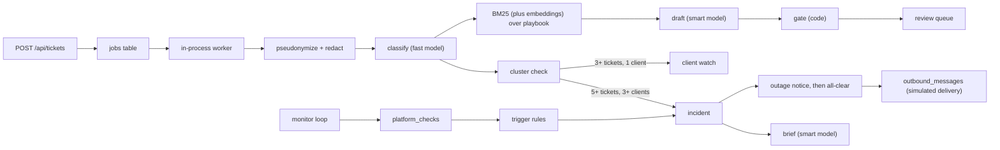

# Design

## Flow

Every model call writes a row to `ai_calls` (purpose, model, prompt version, tokens, latency, cost, status).

## Components

| Path | Responsibility |
| --- | --- |
| `server/pipeline/redact.ts` | Redact emails, phones, cards, credentials, then replace client names and aliases with `[CLIENT_n]` (in that order, so a name inside an email address does not hide it). Detect likely prompt injection. |
| `server/pipeline/classify.ts` | Fast model returns category, platform, priority, sentiment, requested action, summary, confidence. |
| `server/pipeline/retrieve.ts` | MiniSearch BM25 over `server/kb/**.md`, fused with embedding similarity in hybrid mode. Articles for drafts, runbooks for briefs. |
| `server/pipeline/embeddings.ts` | Ollama and offline embedders, cosine similarity, and when hybrid search is on. |
| `server/pipeline/draft.ts` | Smart model writes a reply using only retrieved docs. Citations are checked against the retrieved set. |
| `server/pipeline/gate.ts` | Pure function. Decides `suggest` or `escalate`, computes effective priority, returns reasons. |
| `server/pipeline/incidents.ts` | Ticket cluster check, incident creation and linking, known-issue notes for drafts. |
| `server/pipeline/worker.ts` | Polls `jobs`, retries with backoff, marks tickets for manual triage on final failure. At startup requeues interrupted jobs, and fails those that already used every attempt. |
| `server/monitor/sources.ts` | Status sources: simulated, Statuspage JSON, HTTP probe. |
| `server/monitor/rules.ts` | Pure function. Turns recent checks into open, attach, worsened, recovered, or nothing. |
| `server/monitor/monitor.ts` | Polls sources, stores checks, applies rule results to incidents, sets and clears `recovered_at`. |
| `server/notify/templates.ts` | Default outage and all-clear messages, `{{client}}` and `{{coordinator}}` placeholders, input checks. |
| `server/notify/send.ts` | Who gets each notice, claim-then-send so nobody gets one twice, timeline events. |
| `server/notify/notifier.ts` | `Notifier` interface and the simulated `OutboxNotifier`. |
| `server/ai/structured.ts` | Structured call (Anthropic tool use or Ollama `format`), zod validation, one repair retry, tracing, token budget. |
| `server/ai/anthropic.ts`, `server/ai/ollama.ts`, `server/ai/mock.ts` | Model clients behind one `ModelClient` interface. The mock is deterministic and used for tests and CI. |
| `server/ai/client.ts` | Picks the client for `AI_MODE`. |
| `scripts/services.ts`, `Makefile` | Install, start, and check Ollama; pull and preload models. |
| `server/services.ts` | Actions shared by the JSON API and the HTML pages (review, ack, resolve, notices, simulate). |
| `server/db/index.ts` | Opens SQLite, applies the schema, adds columns missing from older databases. |
| `server/views/`, `server/public/app.js` | Server-rendered pages and htmx partials; live refresh, back links, keyboard shortcuts. |
| `server/live.ts` | Change feed behind `GET /events`: reads the trigger-maintained `live_versions` table and reports which topics changed. |

## Key decisions

**Gate rules are code.** The model proposes; code decides routing. A prompt can be talked out of a rule, a function cannot. Rules:

| Rule | Result |
| --- | --- |
| Effective priority is P1 | escalate |
| Requested action is `takedown`, `public_response`, or `access` | escalate |
| Category is Brand Safety & PR, Billing & Contract, or Account & Access | escalate |
| Card number or credential found in text | escalate |
| Suspected prompt injection | escalate |
| Security, press, legal (including copyright infringement, DMCA, trademark), police, or cancellation keywords | escalate |
| Money words (price, cost, invoice, refund, charged, payment, subscription, a quote, a currency amount, ...) | escalate; a draft must never quote a price |
| Draft not grounded or has no valid citations | escalate |
| Classification or draft confidence below threshold (0.7) | escalate |
| Any AI step failed, timed out, or AI is disabled | escalate (manual triage) |
| Otherwise | suggest |

Effective priority is `max(model priority, tier floor)`. Floors: platinum P2, gold P3, standard P4 (no effect). The model is not told the tier, so its priority reflects the request alone.

Keywords are the backstop for a misclassified ticket, so the legal, police, and money lists include common Spanish, French, and German terms. They are deliberately narrower than the words themselves: "paid social", "quote post", a discount code in a caption, or a platform copyright strike do not escalate.

**Two model tiers.** With `AI_MODE=anthropic`, classification uses Haiku (`MODEL_FAST`): short structured output, called on every request, where speed and cost matter and the code gate backstops routing mistakes. Drafts and incident briefs use Sonnet (`MODEL_SMART`): client-facing tone for high-profile clients and synthesis across many reports. Ollama uses one model for both by default (below). Both are env-configurable; `AI_MODE=anthropic npm run eval -- --fast claude-sonnet-5-5` or `--smart claude-opus-5-5` measures the trade-off.

**Local models through Ollama.** Ollama is the default (`OLLAMA_MODEL_FAST`, `OLLAMA_MODEL_SMART`, both `qwen3:8b` by default), so a fresh checkout gives real model output with no account and no data leaving the machine. Anthropic runs only with `AI_MODE=anthropic`. A key alone does not switch providers: an `ANTHROPIC_API_KEY` exported in a developer's shell would otherwise send client requests to a third party without anyone choosing to. The mock stays for tests and CI, where speed and determinism matter more than realism.

- Structured output uses Ollama's `format` with the same JSON schema the Anthropic tool gets. Generation is constrained to the schema, which small models follow far more reliably than a tool call. The zod validation and the single repair turn are shared; Ollama's repair turn is plain chat (the invalid JSON, then the validation error).
- Thinking is off (`think: false`): it multiplies latency and the gate does not need the reasoning.
- `num_ctx` is 16,384. Ollama's default window is small enough to cut off the retrieved playbook in draft prompts without any error.
- The default timeout is 180 seconds instead of 30, because Ollama serves one request at a time and the others wait in its queue. A second parallel slot was measured and gave no throughput gain on an M1 Pro, so the default is kept.
- One model for both tiers by default: two would compete for memory, and the 8B model is fast enough for classification.

**Starting dependencies.** `make dev` and `make start` run `scripts/services.ts` first. It reads the same config as the server, so it only acts when the mode is `ollama`: starts `ollama serve` in the background if nothing answers (logging to `data/ollama.log`, process ID in `data/ollama.pid` so Stop Zoltar stops only that one), pulls missing models, and loads them into memory so the first ticket does not wait for a model load. `make install` also installs Ollama. A model already in memory is not loaded again, and a load that waits more than 60 seconds behind a busy Ollama finishes in the background rather than blocking the command. A remote `OLLAMA_URL` is checked but never started. The server repeats the check at startup and logs what is missing rather than refusing to start, since tickets still reach the queue for manual triage without AI.

**Running in the background.** `make start` runs `scripts/daemon.ts`, which starts the server as a detached process in its own session (so closing the terminal sends it no SIGHUP), with `NODE_ENV=production`, output appended to `data/zoltar.log` (rotated to `zoltar.log.1` past 10 MB at start), and its process ID in `data/zoltar.pid`, the same files the Mac starter uses. It returns once `/healthz` answers, or prints the end of the log if the app exits while starting. `make stop`, Stop Zoltar, the installer, and the uninstaller all use `scripts/stop.sh`. It stops a Mac starter window through the starter itself (so the window does not report an unexpected stop), then any `server/main.ts` process from the process ID file or whose working directory is this folder; it sends SIGTERM so in-flight work finishes, waits, and force-stops after 10 seconds. A process ID file is trusted only if that process still runs Zoltar, since a stale ID can belong to another program after a crash or reboot. Static files are cached for an hour in production, so their URLs carry a per-start version and a restart reaches browsers at once.

**Mac starter for non-technical users.** `Start Zoltar.command` (double-click) and `install.sh` (one line in Terminal) both run `scripts/start.sh`, which assumes nothing is installed. It deliberately avoids Homebrew and `make`: a fresh Mac has neither, and the built-in `make` prompts for Apple's developer tools.

- Node 24 and Ollama's standalone build are downloaded into `.runtime/` in the project folder and checked against the SHA-256 sums published next to them. That catches a damaged download; it is an integrity check, not proof of origin, since the sums come from the same site. No installer and no admin password. Outside the folder it writes only the model (`~/.ollama`), npm's download cache (`~/.npm`), and a compile cache in the temp folder, all removed by the uninstaller when Zoltar created them. An existing Node 24+, Ollama on `PATH`, or the Ollama desktop app is used instead when present.
- It picks `qwen3:4b` instead of `qwen3:8b` when writing `.env` on a Mac with less than 16 GB of memory, refuses to start the model download with less than 8 GB free (whenever the configured model is not on disk yet), and reuses a running Zoltar instead of failing on the port.
- Settings are read by `scripts/settings.ts`, which validates `.env` with the server's own config code and prints them single-quoted, so a mistake in `.env` shows a plain message and nothing in it can run as a shell command.
- The app runs while the Terminal window is open. Closing the window (SIGHUP), Control-C, or `Stop Zoltar.command` stop it. Shutdown waits at most 3 seconds for model calls in progress; interrupted jobs are requeued on the next start, so nothing is lost and closing the window does not hang.
- Errors are written for the person in front of the Mac ("Not enough disk space: ..."), with details in `data/zoltar.log`.
- Files fetched with `curl` carry no quarantine flag, which is why the one-line install avoids the macOS "could not verify" prompt that a downloaded ZIP gets.
- Uninstalling removes only what Zoltar added. Guessing from what is on disk would delete things the user already had, such as a Homebrew Node or their own Ollama models. So each installer appends what it adds to `.zoltar-installed`: Homebrew formulas that were new (a before/after diff of `brew list`, so dependencies such as `mlx` are included), each model pulled, and `~/.ollama` or `~/.npm` if they did not exist yet. `scripts/uninstall.sh` (`Uninstall Zoltar.command`, `make uninstall`) deletes models through Ollama's API rather than deleting blob files, because blobs can be shared with other models. It removes `~/.ollama` only if nothing else is left in it (reading the model list from disk if Ollama cannot be reached), stops `ollama serve` only when that Ollama is Zoltar's, and deletes the whole folder only when `install.sh` created it.

**Structured output through tool use.** The tool's JSON schema comes from the zod schema, so the model contract and the validator cannot drift. A forced tool call is used where the model supports it (Haiku); models that reject it (Sonnet and Opus 5.5) get `tool_choice: auto`. Parallel tool calls are disabled so the answer arrives as one call. If validation fails, the error goes back once as a tool result for every tool call in the turn, with the original assistant content (including thinking blocks) replayed unchanged. A second failure routes the ticket to a human, or marks the brief failed.

**BM25 first, embeddings when the playbook grows.** The playbook is 20 short docs with distinctive vocabulary, so BM25 alone is the default: no extra model, deterministic, easy to debug. Hybrid search (`KB_SEARCH=hybrid`, or `auto` from 40 documents in Ollama mode) adds a local embedding model.

- Both rankings take their top 10 candidates and are combined by reciprocal rank fusion (`1 / (60 + rank)` summed per document), so a document either method ranks highly comes back, and agreement ranks first. Fusion uses ranks, not raw scores, because BM25 scores and cosine similarities are not on the same scale.
- Floors keep unrelated text from retrieving anything: an embedding-only match needs similarity 0.6; a keyword match needs 0.5, which removes BM25's fuzzy matches on unrelated words. Both were set with `npm run eval:retrieval` for `nomic-embed-text` and must be rechecked for another model.
- Document vectors are cached in `kb_embeddings`, keyed by model and a hash of the text, so the playbook is embedded once (about 7 seconds on first use) and an edited article is re-embedded alone. The query is pseudonymized ticket text, and it goes only to Ollama at `OLLAMA_URL` (this machine by default). The playbook is embedded at startup rather than on the first ticket. If the model is re-pulled with a different vector size, cached vectors are dropped and rebuilt.
- `nomic-embed-text` needs `search_query:` and `search_document:` prefixes; other models get the plain text.
- Auto mode never turns hybrid on with `AI_MODE=anthropic`, which may have no Ollama at all. Explicit `KB_SEARCH=hybrid` there uses Ollama at `OLLAMA_URL` for embeddings only.
- A query embedding runs inside every triage, so it has a 10-second limit (documents get 120 seconds): when Ollama is busy with a long chat request, keyword search beats waiting.
- In mock mode the word-hashing embedder scores far below a real model, so the similarity floors are not applied there.
- If the embedding model fails or is missing, search logs `kb_embeddings_unavailable_using_keyword_search`, uses BM25 alone, and tries again after a minute. A ticket never fails because of retrieval. `/healthz` reports the search mode and lists a missing embedding model.

**One incident per platform and category, two signals.** The monitor and ticket clusters both key incidents on `(platform, category)`. Whichever fires first opens the incident; the other attaches and is recorded in `sources` and the timeline. Monitor components map to categories: `publishing` to Publishing & Scheduling, `analytics` to Analytics & Reporting. When the monitor opens an incident, recent matching tickets are linked retroactively.

**Monitor trigger rules.**

| Latest checks | Result |
| --- | --- |
| 1 `outage` | open incident, or attach to the existing one |
| `degraded` or worse for 20 s (`MONITOR_DEGRADED_MS`) | open or attach |
| `degraded` then `outage` on an open incident | worsened event |
| `operational` for 30 s (`MONITOR_RECOVERY_MS`) on an incident the monitor saw | recovered event, `recovered_at` set, green banner; Ops still resolves |
| Failing again after recovery | `recovered_at` cleared, timeline says hold the all-clear |
| `unknown` (source failed) | nothing |
| Still failing after Ops resolved the incident | nothing; a new failure after an operational check opens a new incident |
| `outage` after Ops resolved a `degraded` incident | open a new incident: it got worse |

Thresholds are durations measured between check times, not check counts, so "Run checks now" or a simulated status change cannot open an incident or note recovery sooner. With the default 10-second interval, degraded opens on the third check and recovery is noted on the fourth. A streak is measured from its first check to the latest, with one second allowed for timer jitter so a 20-second streak measured as 19.99 seconds still counts. A short run of `unknown` checks is skipped, but known checks more than two intervals apart (plus the jitter allowance) break a streak: a stopped server, a sleeping laptop, or a failing source means nobody saw the platform, and an hour unseen must not count as an hour degraded. Checks are ordered by insertion, so a clock that steps back cannot reorder them. Whether a resolved incident may reopen depends on whether the component has had an operational check since it was resolved, or has gone from degraded to a full outage, not on the check history kept for the rules.

A failing status source is not a failing platform. Treating it as one would page Ops every time a status page is slow. Statuspage errors, connection errors, and a probe URL returning 4xx (misconfigured) are `unknown`; an HTTP probe that times out or returns 5xx is an `outage`, because that is what the platform's own API is doing.

**Ticket cluster thresholds count distinct clients.** Five complaints from one client is a client problem; five from three or more clients is a platform problem. Single-client clusters become a "client watch" with no model call.

**Proactive outreach.** An incident lists every client on the affected platform, platinum first, with whether they already reported it and whether they have been told. The brief includes a client-comms macro.

**Client notices.** Two notices per platform incident, both sent by a person, never automatically:

| Notice | Who gets it | When |
| --- | --- | --- |
| Outage | Affected clients not yet told (by notice or "Mark notified") | Incident open |
| All-clear | Everyone who heard about the outage: got the notice, was marked notified, or reported it themselves | "Resolve and send all-clear"; resolves the incident in the same step |

- The default message comes from a template, not the model, and says the platform caused the problem, not the client's account or content. Ops reviews and edits it before sending. Only `{{client}}` and `{{coordinator}}` are filled in; any other placeholder or a multi-line subject is refused before anything is sent.
- Each send claims a row in `outbound_messages` first, unique on `(incident, client, kind)`, so a double click or two coordinators at once cannot send twice. A failed send keeps its row as `failed` and is retried on the next send; sent rows are never repeated. A row left in `sending` by a restart is marked `failed` at startup, so it shows up for a retry instead of counting as delivered.
- Clients with no contact email are skipped and named in the timeline so someone calls them.
- Delivery goes through a `Notifier` interface. The only implementation, `OutboxNotifier`, records the message and does not send it. A real provider would be a second implementation, with no change to the workflow.
- Recovery is a fact the monitor records (`recovered_at`), not an action. The banner offers the all-clear; a person decides to send it, since 30 seconds of healthy checks does not prove clients' posts are publishing again.

**Server-rendered UI.** The workflow is a queue, a detail page, and a few actions; all state is on the server. Hono JSX renders pages, htmx swaps fragments for review actions and live updates, and `app.js` adds keyboard shortcuts. Actions are plain forms, so they work without JS. The JSON API is kept separate, so a richer client could be added later without touching the pipeline.

- Live updates use Server-Sent Events. Triggers on each table bump a version per topic (`tickets`, `incidents`, `platforms`, `ops`) in `live_versions`; the server reads that small table every 500 ms while a page is connected and sends `event: change` with the topics that moved. Each live container lists its topics in `data-live`, and `app.js` fires htmx's `live` trigger on the ones that match, coalescing bursts into one request. Reading the database instead of emitting events from code also catches writes by other processes using the same database file.
- A live container also refreshes every 60 seconds, which keeps "5m ago" current and covers a dropped connection. The server starts counting changes when a stream opens, so the page refreshes everything on every `ready` event: on connect (catching changes made while the page loaded) and after a reconnect. EventSource retries a dropped connection itself but gives up on an HTTP error (the 50-stream cap, a proxy error during a restart), so `app.js` reconnects after 5 seconds. Going Back refetches the page; the htmx history cache is off, which also keeps client messages out of `localStorage`.
- The top bar is a live container too, so the open-incident count and the AI badge update without navigating.
- A hidden tab closes its stream and catches up when shown again. Browsers allow six HTTP/1.1 connections per site, so a stream held by every open tab would soon stall page loads. The server caps streams at 50.
- A refresh is held while a form control has focus, a notice form is open, keyboard focus is inside the container, or a control inside it has an unsubmitted change (for example a Simulate dropdown, whose Set button takes focus away before it is clicked), and runs as soon as that ends, so it never discards a half-written message or drops focus. Refreshes now happen only when data changed, so they rarely meet the user at all.
- Ticket pages are live only while triage runs, and incident pages while the incident is open or its brief is pending, so a coordinator editing a draft is never refreshed.
- Confirmations ("Send to 5 clients?") run in the capture phase, before htmx sends a boosted form; a bubbling listener would ask after the request had already gone.
- The simulate control on the Platforms page has a Set button rather than submitting on change: arrowing through the list would otherwise pass through `outage` and open a real incident.
- The acting person always comes from the "Working as" cookie, never from a form field.
- Ticket and incident pages have a back link to the list you came from (for example "Back to Draft ready queue"), kept in `sessionStorage` per tab. Without JS it falls back to the queue or the incident list.
- Live containers set `hx-disinherit="hx-select hx-swap hx-sync"` so their swap settings do not leak into boosted links inside them. They name the attributes: `*` would also cut off `hx-boost` from the page, and every link and form inside would do a full page load. `hx-sync="this:queue last"` gives a change that lands mid-refresh its own request.
- Notice forms post the recipients they showed; if the list changed while the form was open, the send is refused with the new list.

**SQLite job table instead of a queue.** One process, durable jobs, retries survive restarts. `node:sqlite` is synchronous, so cluster checks and incident inserts cannot interleave within the process.

**Pseudonymization before every model call.** Client names and aliases come from the roster. The model sees `[CLIENT_3]`; the coordinator sees the real name after rehydration.

## Failure handling

| Failure | Handling |
| --- | --- |
| Timeout, 429, 5xx | Job retries with backoff (3 attempts); the Anthropic SDK's own retries are off so one call cannot run for several times `AI_TIMEOUT_MS`. Final failure: ticket escalated as manual triage. |
| Malformed model output | One repair retry with the validation error. Then escalate. |
| Hallucinated citation | Dropped. No valid citations means not grounded, which escalates. |
| Prompt injection | Ticket text, earlier summaries, and status page messages are wrapped in `<ticket>`, `
`, and `<signals>` tags and treated as data, with any embedded wrapper tags removed. Heuristic detector escalates. The model cannot take actions. |
| Token budget exceeded | Remaining steps skipped, ticket escalated. |
| Ollama stopped | Transient error, job retries with backoff, then manual triage. Startup log and `/healthz` say so; `make services` starts it. |
| Ollama model not pulled | Permanent error naming the `ollama pull` command; no retries. |
| Local model emits text instead of JSON | Kept as text so validation fails with a readable error; one repair turn. |
| AI provider down for a long time | Kill switch in Ops page or `AI_MODE=disabled`. Tickets still reach the queue; monitoring still opens incidents (without a brief). Brief jobs queued before the switch skip the model, and Regenerate is refused until AI is back on. |
| Status source down or misconfigured | Check recorded as `unknown`, logged, shown on the Platforms page. No incident. |
| Flapping platform status | Debounce on `degraded`; one open incident per platform and category. |
| Duplicate ingestion | `external_id` is unique; repeat posts return the existing ticket. |
| Brief generation fails | Incident stays open with the runbook; timeline records the failure; Regenerate retries. |
| Process stopped mid-job | Job requeued at startup; a job interrupted on its last attempt fails, so a request that crashes the process cannot loop. |
| Worker database error (e.g. busy) | Logged; the worker keeps polling instead of crashing the process. |
| Invalid setting (zero or negative count, timeout, or interval) | Startup refuses with the setting's name. |
| Notice delivery fails | Row kept as `failed` with the error; sending again retries only failed and unsent clients. |
| Double-clicked or concurrent send | Unique `(incident, client, kind)` claim; the second request skips everyone already claimed. |
| Client has no contact email | Skipped and named in the timeline for a phone call. |
| Platform relapses after recovery | `recovered_at` cleared, banner removed, timeline says hold the all-clear. |
| Database from an older version | Missing columns added at startup; seeded contact emails filled in. |

## Observability

- Structured JSON logs (pino) with `request_id`, `ticket_id`, `job_id`, `incident_id`.
- `ai_calls` table for every model call; `platform_checks` for every status check; `outbound_messages` for every client notice.
- Incident timeline in `incident_events`, including notices sent, failed, and skipped.
- `GET /api/metrics`: latency p50/p95 per step, cost, tokens, error rate, escalation rate and reasons, draft acceptance and edit distance by tier, queue depth, time to triage.
- `GET /healthz`: DB check, AI mode, queue counts, last successful model call, last monitor check. In Ollama mode, also whether Ollama answers and has the configured models. Reports `degraded` when a job failed in the last minute, the monitor is stale, or Ollama is not ready, and returns to `ok` a minute after the last failure.

## Scaling

The bottleneck is model latency (seconds per ticket), not the server. At 150 tickets/day the single process is idle most of the time. The load that matters is bursty: a platform outage can produce dozens of tickets in minutes.

| Need | Change |
| --- | --- |
| More throughput | Raise `WORKER_CONCURRENCY` until provider rate limits are hit. With Ollama, throughput is set by the GPU: use a smaller fast model, a bigger machine, or point `OLLAMA_URL` at a shared GPU server. |
| Multiple instances | Move jobs to Postgres (`SELECT ... FOR UPDATE SKIP LOCKED`) or a managed queue. Add a unique constraint on open `(platform, category)` incidents. Run the monitor as a single leader. |
| Outage bursts | Tickets linked to an open incident can skip drafting and use the approved macro. |
| Cost | Cache classification for near-duplicate text; prompt caching for the static system prompt and playbook. |
| Larger playbook | Hybrid search is built in; beyond a few hundred documents, chunk long articles and add a reranker. |
| Live UI at scale | Several app instances need a shared change feed (Postgres `LISTEN/NOTIFY` or Redis pub/sub) instead of reading `live_versions` in each process. |

## Extensions

- Per-client publish telemetry from MMC's scheduler as a third signal (failure rate per platform). It would also confirm recovery from real posts before the all-clear.
- Real notice delivery: a `Notifier` for MMC's email provider or client portal, with delivery receipts.
- Feedback loop: coordinator edits become eval cases.
- Streamed drafts over the existing Server-Sent Events connection.
- A richer client on top of the existing JSON API if MMC needs a multi-pane console.
- NER-based redaction for names not in the roster.
- Auth, per-coordinator queues, SLA timers.
